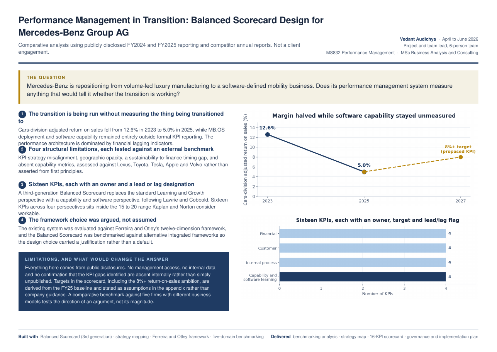

# Mercedes-Benz: Balanced Scorecard for a Software-Defined Transition

> Mercedes-Benz is repositioning from volume-led luxury manufacturing to a software-defined mobility business. Does its performance management system measure anything that would tell it whether the transition is working?

| | |
|---|---|
| **Role** | Project and team lead, 6-person team |
| **Context** | MS832 Performance Management · MSc Business Analysis and Consulting, University of Strathclyde · Apr–Jun 2026 |
| **Evidence base** | Public FY2024 and FY2025 disclosures and competitor annual reports. Not a client engagement. |
| **Methods** | Third-generation Balanced Scorecard · strategy mapping · Ferreira and Otley twelve-dimension framework · benchmarking against five firms |

## Key findings

1. **The transition is being run without measuring the thing being transitioned.** Cars-division adjusted return on sales fell from **12.6% in 2023 to 5.0% in 2025**, while MB.OS deployment and software capability sat entirely outside formal KPI reporting. The architecture is dominated by financial lagging indicators.
2. **Four structural limitations, each tested against an external benchmark:** KPI-strategy misalignment, geographic opacity, a sustainability-to-finance timing gap and absent capability metrics, assessed against Lexus, Toyota, Tesla, Apple and Volvo.
3. **Sixteen KPIs, each with an owner and a lead or lag designation.** A capability and software perspective replaces the standard Learning and Growth perspective (Lawrie and Cobbold). Sixteen sits inside the 15–20 range Kaplan and Norton consider workable.
4. **The framework choice was argued, not assumed.** The existing system was evaluated against Ferreira and Otley's framework, and the Balanced Scorecard was benchmarked against alternative integrated frameworks.

## Deliverables

Benchmarking analysis · strategy map · 16-KPI scorecard (objective, lead/lag flag, target, initiative and owner per KPI) · governance and implementation plan

## Limitations

- Everything comes from public disclosures: no management access, no internal data, and no confirmation that the KPI gaps are absent internally rather than simply unpublished.
- Scorecard targets, including the **8%+ return-on-sales ambition by FY27**, are derived from the FY25 baseline and stated as assumptions, **not company guidance**.
- A benchmark against five firms with different business models tests the direction of the argument, not its magnitude.

## Files

- [`one-pager.pdf`](one-pager.pdf) — one-page project summary

---
**Vedant Audichya** · MSc Business Analysis and Consulting, University of Strathclyde · [LinkedIn](https://www.linkedin.com/in/vedantaudichya) · [All projects](https://github.com/Vedant-Au)
